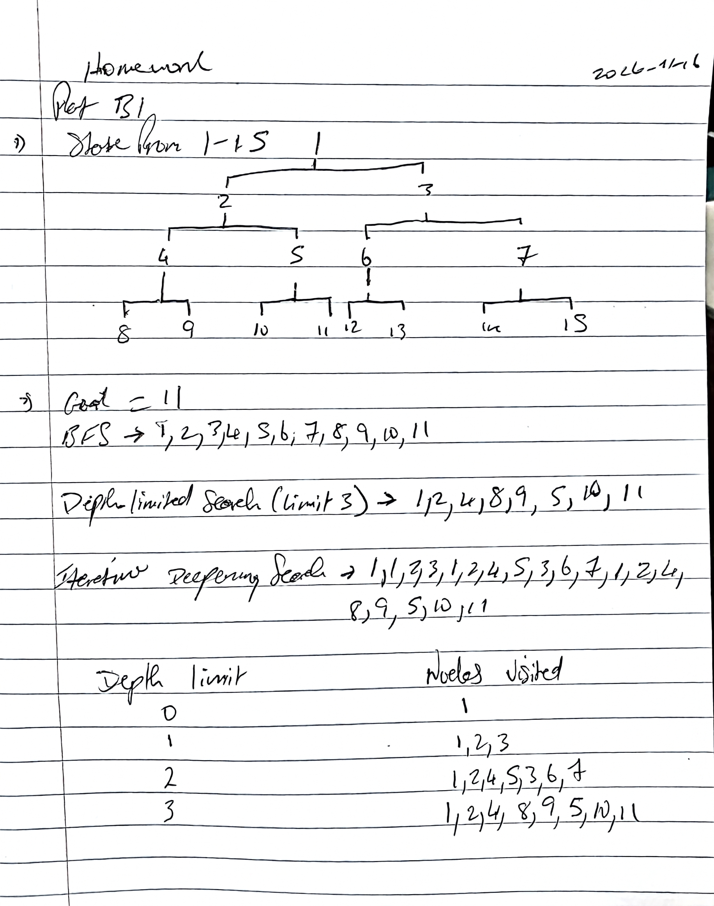

# HW0 Written Answers

**Name: Steve Samuels**

**Student ID: 1036804**

Q1: I implemented the DFS function with help from Copilot.
A stack was used as the data structure, tiny maze had a cost of 10,medium maze had a cost of 130, and big maze 210.
Autograder gave a 3/3 grading.

Q2: I implemented the BFS function with help from Copilot.
A queue was used as the data structure, medium maze had a cost of 68, and big maze 210.
BFS did gain a lower cost.
The implementation also ran the 8puzzle search and completed it successfully.
Autograder gave a 3/3 grading.

Q3: I implemented the UCS function with help from Copilot.
A priority queue was used as the data structure. Medium maze had a cost of 68, mediumDottedMaze had a cost of 1, and mediumScaryMaze had a cost of 68719479864. As seen, an extremely low and high cost was given from the two different search agents.
Autograder gave a 3/3 grading.

Q4: I implemented the A* function with help from Copilot.
A priority queue was used as the data structure. BigMaze had a cost of 210, 549 search nodes expanded using A* with the manhattanHeuristic.

**OpenMaze Results:**
A* and heuristic manhattanHeuristic: Path found with total cost of 54 in 0.0 seconds
Search nodes expanded: 535
Pacman emerges victorious! Score: 456

DFS: Path found with total cost of 298 in 0.0 seconds
Search nodes expanded: 576
Pacman emerges victorious! Score: 212

BFS: Path found with total cost of 54 in 0.0 seconds
Search nodes expanded: 682
Pacman emerges victorious! Score: 456

UCS: Path found with total cost of 54 in 0.0 seconds
Search nodes expanded: 682
Pacman emerges victorious! Score: 456

Autograder gave a 3/3 grading.

Q5: I implemented the `CornersProblem` search problem in searchAgents.py with help from Copilot. Each search state stores Pacman's position and a tuple recording which of the four corners have been visited. This avoids including irrelevant game information, while preserving the information needed to recognize the goal. Legal moves have a step cost of 1, so BFS finds a shortest path that visits all four corners.

**tinyCorners Results:**
BFS found a path with a total cost of 28, matching the expected shortest path.
Search nodes expanded: 252
Pacman emerges victorious! Score: 512

**mediumCorners Results:**
BFS found a path with a total cost of 106.
Search nodes expanded: 1966
Pacman emerges victorious! Score: 434

Autograder gave a 6/6 grading.

Q6: I implemented the `cornersHeuristic` function with help from Copilot. The heuristic estimates the remaining path cost by finding the maze distance from Pacman to the nearest unvisited corner, then adding the minimum spanning tree cost connecting all remaining corners. I used maze distances that respect walls, and cached the distance maps so they could be reused during A* search. This estimate is admissible because any route that visits every remaining corner must at least reach one of them and connect all of them.

**mediumCorners Results:**
A* with cornersHeuristic found a path with a total cost of 106.
Search nodes expanded: 196
Pacman emerges victorious! Score: 434

Autograder gave a 6/6 grading.

Q7: I implemented the `foodHeuristic` function with help from Copilot. The heuristic finds the maze distance between Pacman's position and each remaining food dot, and between pairs of remaining food dots. It returns the greatest of those distances. Since any complete route must connect every remaining food location, its length must be at least this greatest pairwise distance. The heuristic is non-negative, returns 0 when no food remains, and uses maze distances that account for walls. Distance maps are cached in `problem.heuristicInfo` to avoid repeating the same breadth-first searches.

**testSearch Results:**
A* found a path with a total cost of 7 in 0.0 seconds.
Search nodes expanded: 8
Pacman emerges victorious! Score: 513

**trickySearch Results:**
A* found a path with a total cost of 60 in 0.0 seconds.
Search nodes expanded: 1130
Pacman emerges victorious! Score: 570

Autograder gave a 8/7 grading, including the extra-credit.

Q8: I implemented `findPathToClosestDot` and `AnyFoodSearchProblem.isGoalState` functions with help from Copilot. The goal test returns true when Pacman's current position contains food. `findPathToClosestDot` runs BFS on this problem, which returns a shortest path to any remaining dot. The agent repeats this process after eating each dot.

This greedy strategy is not guaranteed to find the shortest path for eating all the dots. Each BFS finds the nearest dot from Pacman's current position, but it does not consider how the choice affects the distance to the dots left afterward. For example, consider a small weighted maze graph with start S and food dots A, B, C, and D. If the shortest-path distances are S-to-(A,B,C,D) = (19, 19, 15, 20), A-to-(B,C,D) = (22, 25, 29), B-to-(C,D) = (13, 21), and C-to-D = 20, greedy chooses C, then B, D, and A, for a total of 78. The order A, B, C, D costs 19 + 22 + 13 + 20 = 74. Thus, repeatedly choosing the nearest dot can produce a longer total route.

**bigSearch Results:**
ClosestDotSearchAgent found a path with a total cost of 350.
Pacman emerges victorious! Score: 2360

Autograder gave a 3/3 grading.
---

## Part B: Written Problems

### B1. State spaces and uninformed search

1.State space for states 1 to 15
2.
3.Bidirectional search

Bidirectional search works very well here.
Forward branching factor: 2. Each state k has successors 2k and 2k+1.
Backward branching factor: 1. Each state k > 1 has exactly one predecessor, ⌊k/2⌋. From 11 the backward path is 11 → 5 → 2 → 1.

Because the backward direction has no branching, it is a single path of length d. The forward search only needs to expand a few levels before meeting it. For goal 11, the two searches meet after a couple of steps, giving the solution 1 → 2 → 5 → 11.

In general, a single-direction search to depth d costs O(2^d), but the backward search alone costs only O(d) = O(log n) for goal n. You can even skip the forward search entirely and just follow predecessors back to 1. This is a case where the reverse direction is far cheaper than the forward one, so bidirectional search (or just backward search) is dramatically better than plain BFS or IDS.
4.Solution without search

Left appends a 0 bit and Right appends a 1 bit, so the actions for goal g are just the binary digits of g after the leading 1.
function solve(g):
    actions = []
    while g > 1:
        if g is odd: add "Right" to actions
        else:        add "Left" to actions
        g = g / 2   (integer division)
    return actions reversed

Example: g = 11 = 1011 in binary, so the actions are Left, Right, Right (1 → 2 → 5 → 11).

This takes O(log g) time with no search at all.

What this says about problem formulation: A good formulation can matter more than the search algorithm. BFS or IDS costs O(2^d), backward search costs O(d), and using the binary structure gives the answer directly. Looking for structure in the problem first (like a unique predecessor or a numeric pattern) can remove the need for search entirely.

### B2. Problem formulation and heuristics

1.State space size

Vehicles are distinguishable (order matters) and no two share a square. Vehicle 1 has n² choices, vehicle 2 has n² − 1, and so on:

|S| = n²(n² − 1)…(n² − n + 1) = (n²)! / (n² − n)!

(roughly (n²)ⁿ as an upper bound)

2.Branching factor

Each vehicle has 5 choices (up, down, left, right, stay), and all vehicles move at the same time. So:

b ≈ 5ⁿ joint actions.

This is an upper bound, since some actions are illegal (off-grid or collisions). Hops add a few extra options per vehicle (a hop is a 2-square move over a stationary neighbour), so the strict bound is ≤ 9ⁿ, but 5ⁿ is the usual answer.

3.Heuristic for vehicle i at (x, y)

The goal is (n − i + 1, n). The Manhattan distance is

dᵢ = |x − (n − i + 1)| + |n − y|

A hop moves a vehicle 2 squares in one step, so dᵢ can overestimate in the full problem. To be safe:

hᵢ = (|x − (n − i + 1)| + |n − y|) / 2

This is admissible because a vehicle covers at most 2 squares of distance per step. It’s nontrivial since it’s > 0 away from the goal. (If you ignore hops, plain Manhattan distance works.)

4. Which are admissible for the whole problem?

(a) ∑ hᵢ: not admissible. All vehicles move simultaneously in one step, so one step can reduce every hᵢ at once. The sum counts the same time step n times and overestimates. Example: n vehicles each needing 1 move takes 1 step, but the sum is n·hᵢ.

(b) maxᵢ hᵢ: admissible. Every vehicle must reach its goal, so the total time is at least the time the slowest vehicle needs on its own. Ignoring the other vehicles only removes constraints, so this is a lower bound on the true cost. It’s also the tightest of the three.

(c) minᵢ hᵢ: admissible, but weak. minᵢ hᵢ ≤ maxᵢ hᵢ ≤ true cost, so it never overestimates. It’s less informative, though, because it only reflects the vehicle closest to its goal (and is often 0).

### B3. Proofs about heuristics

1.Consistency ⇒ admissibility

Definitions: h is consistent if h(n) ≤ c(n,n’) + h(n’) for every node n and successor n’. h is admissible if h(n) ≤ h*(n), the true cost to the goal.

Proof (induction on the number of steps k from n to the goal along an optimal path):

Base case (k = 0): n is the goal, so h(n) = 0 = h*(n). ✓
Inductive step: suppose it holds for every node k−1 steps from the goal. Take n whose optimal path has k steps, with first successor n’ on that path. Then h*(n) = c(n,n’) + h*(n’).
Consistency: h(n) ≤ c(n,n’) + h(n’)
Induction hypothesis: h(n’) ≤ h*(n’)
So h(n) ≤ c(n,n’) + h*(n’) = h*(n). ✓

(Equivalent view: add up the consistency inequality along the optimal path n = n₀, n₁, …, n_k = goal. The h terms cancel (telescoping), leaving h(n) ≤ total path cost + h(goal) = h*(n).)

2.Max is admissible: for every n, h₁(n) ≤ h*(n) and h₂(n) ≤ h*(n). So max(h₁(n), h₂(n)) ≤ h*(n). ✓

Sum is NOT admissible in general. Counterexample: let h*(n) = 10 and h₁(n) = h₂(n) = 8. Both are admissible (8 ≤ 10), but h₁ + h₂ = 16 > 10. ✗

(Concrete version: a path graph S → G with cost 1. Take h₁(S) = h₂(S) = 1. Each is admissible, but the sum is 2 > h*(S) = 1.)

3.Weighted A*

Claim: the returned solution cost C ≤ w·C*, where C* is the optimal cost.

Proof:

a.Let n be a node on an optimal path that is still on the frontier when weighted A* is about to pick the goal G. (One always exists: the optimal path starts at the root and ends at the goal, so some node on it is on the frontier.)

b.Because h is admissible, g(n) + h(n) ≤ C*, and g(n) ≤ C* too (n is on the optimal path; with consistent h, g(n) is optimal for n).

c.Then f(n) = g(n) + w·h(n) ≤ w·(g(n) + h(n)) ≤ w·C*. (The first step uses w ≥ 1, so g(n) ≤ w·g(n).)

d.G is chosen before n, so f(G) ≤ f(n). Also h(G) = 0, so f(G) = g(G) = C.

e.Therefore C = f(G) ≤ f(n) ≤ w·C*.

Why accept a suboptimal answer? Speed and memory. A larger w makes the search more greedy, so it expands far fewer nodes. You get a solution that is guaranteed to be within a factor w of optimal, much faster. This is useful when the problem is huge, time is limited, or “good enough” is fine (e.g. robot path planning).

### B4. Hand trace: Bartica to Ituni
Straight-line distances to Ituni (km) used for A*

| Town | h (km) |
|:---|---:|
| Ituni | 0.0 |
| Kwakwani | 36.7 |
| Linden | 53.5 |
| Mahdia | 102.6 |
| Bartica | 105.1 |
| Kurupukari | 106.7 |
| Timehri | 108.8 |
| Soesdyke | 112.5 |
| New Amsterdam | 113.8 |
| Rosignol | 114.6 |
| Corriverton | 130.2 |
| Diamond | 131.6 |
| Mahaica | 133.1 |
| Ogle | 138.3 |
| Georgetown | 141.8 |
| Vreed en Hoop | 142.2 |
| Parika | 148.7 |
| Anna Regina | 193.9 |
| Annai | 200.5 |
| Charity | 210.6 |
| Lethem | 294.4 |

## BFS (expansion order, fringe at each step)

| Step | Expand | Fringe after expanding |
|:---:|:---|:---|
| 1 | Bartica | Mahdia, Parika |
| 2 | Mahdia | Parika, Linden |
| 3 | Parika | Linden, Anna Regina, Vreed en Hoop |
| 4 | Linden | Anna Regina, Vreed en Hoop, Ituni (generated, so BFS stops) |

**UCS** (expansion order, fringe and g at each step):
=== UCS ===
 1. expand Bartica (g=0.0)
      fringe: Parika(235.2), Mahdia(265.8)
 2. expand Parika (g=235.2)
      fringe: Mahdia(265.8), Vreed en Hoop(266.1), Anna Regina(293.3)
 3. expand Mahdia (g=265.8)
      fringe: Vreed en Hoop(266.1), Anna Regina(293.3), Linden(461.3)
 4. expand Vreed en Hoop (g=266.1)
      fringe: Georgetown(281.6), Anna Regina(293.3), Linden(461.3)
 5. expand Georgetown (g=281.6)
      fringe: Ogle(288.6), Anna Regina(293.3), Diamond(294.6), Timehri(325.4), Linden(461.3)
 6. expand Ogle (g=288.6)
      fringe: Anna Regina(293.3), Diamond(294.6), Mahaica(321.6), Timehri(325.4), Linden(461.3)
 7. expand Anna Regina (g=293.3)
      fringe: Diamond(294.6), Charity(318.5), Mahaica(321.6), Timehri(325.4), Linden(461.3)
 8. expand Diamond (g=294.6)
      fringe: Soesdyke(315.7), Charity(318.5), Mahaica(321.6), Timehri(325.4), Linden(461.3)
 9. expand Soesdyke (g=315.7)
      fringe: Charity(318.5), Mahaica(321.6), Timehri(324.2), Linden(391.0)
10. expand Charity (g=318.5)
      fringe: Mahaica(321.6), Timehri(324.2), Linden(391.0)
11. expand Mahaica (g=321.6)
      fringe: Timehri(324.2), Rosignol(387.2), Linden(391.0)
12. expand Timehri (g=324.2)
      fringe: Rosignol(387.2), Linden(391.0)
13. expand Rosignol (g=387.2)
      fringe: Linden(391.0), New Amsterdam(399.7)
14. expand Linden (g=391.0)
      fringe: New Amsterdam(399.7), Ituni(456.8), Kwakwani(498.2), Kurupukari(617.8)
15. expand New Amsterdam (g=399.7)
      fringe: Ituni(456.8), Corriverton(473.9), Kwakwani(498.2), Kurupukari(617.8)
16. expand Ituni (g=456.8)  <- GOAL, stop

**A\*** (expansion order, fringe with g, h, f at each step):
=== A* ===
 1. expand Bartica (g=0.0, h=105.1, f=105.1)
      fringe: Mahdia(g=265.8, h=102.6, f=368.4), Parika(g=235.2, h=148.7, f=383.9)
 2. expand Mahdia (g=265.8, h=102.6, f=368.4)
      fringe: Parika(g=235.2, h=148.7, f=383.9), Linden(g=461.3, h=53.5, f=514.8)
 3. expand Parika (g=235.2, h=148.7, f=383.9)
      fringe: Vreed en Hoop(g=266.1, h=142.2, f=408.3), Anna Regina(g=293.3, h=193.9, f=487.2), Linden(g=461.3, h=53.5, f=514.8)
 4. expand Vreed en Hoop (g=266.1, h=142.2, f=408.3)
      fringe: Georgetown(g=281.6, h=141.8, f=423.4), Anna Regina(g=293.3, h=193.9, f=487.2), Linden(g=461.3, h=53.5, f=514.8)
 5. expand Georgetown (g=281.6, h=141.8, f=423.4)
      fringe: Diamond(g=294.6, h=131.6, f=426.2), Ogle(g=288.6, h=138.3, f=426.9), Timehri(g=325.4, h=108.8, f=434.2), Anna Regina(g=293.3, h=193.9, f=487.2), Linden(g=461.3, h=53.5, f=514.8)
 6. expand Diamond (g=294.6, h=131.6, f=426.2)
      fringe: Ogle(g=288.6, h=138.3, f=426.9), Soesdyke(g=315.7, h=112.5, f=428.2), Timehri(g=325.4, h=108.8, f=434.2), Anna Regina(g=293.3, h=193.9, f=487.2), Linden(g=461.3, h=53.5, f=514.8)
 7. expand Ogle (g=288.6, h=138.3, f=426.9)
      fringe: Soesdyke(g=315.7, h=112.5, f=428.2), Timehri(g=325.4, h=108.8, f=434.2), Mahaica(g=321.6, h=133.1, f=454.7), Anna Regina(g=293.3, h=193.9, f=487.2), Linden(g=461.3, h=53.5, f=514.8)
 8. expand Soesdyke (g=315.7, h=112.5, f=428.2)
      fringe: Timehri(g=324.2, h=108.8, f=433.0), Linden(g=391.0, h=53.5, f=444.5), Mahaica(g=321.6, h=133.1, f=454.7), Anna Regina(g=293.3, h=193.9, f=487.2)
 9. expand Timehri (g=324.2, h=108.8, f=433.0)
      fringe: Linden(g=391.0, h=53.5, f=444.5), Mahaica(g=321.6, h=133.1, f=454.7), Anna Regina(g=293.3, h=193.9, f=487.2)
10. expand Linden (g=391.0, h=53.5, f=444.5)
      fringe: Mahaica(g=321.6, h=133.1, f=454.7), Ituni(g=456.8, h=0.0, f=456.8), Anna Regina(g=293.3, h=193.9, f=487.2), Kwakwani(g=498.2, h=36.7, f=534.9), Kurupukari(g=617.8, h=106.7, f=724.5)
11. expand Mahaica (g=321.6, h=133.1, f=454.7)
      fringe: Ituni(g=456.8, h=0.0, f=456.8), Anna Regina(g=293.3, h=193.9, f=487.2), Rosignol(g=387.2, h=114.6, f=501.8), Kwakwani(g=498.2, h=36.7, f=534.9), Kurupukari(g=617.8, h=106.7, f=724.5)
12. expand Ituni (g=456.8)  <- GOAL, stop

| Algorithm | Route | Cost (km) | Optimal? | Nodes expanded |
|:---|:---|---:|:---:|---:|
| BFS | Bartica → Mahdia → Linden → Ituni | 527.1 | No | 4 |
| UCS | Bartica → Parika → Vreed en Hoop → Georgetown → Diamond → Soesdyke → Linden → Ituni | 456.8 | Yes | 15 |
| A* | Bartica → Parika → Vreed en Hoop → Georgetown → Diamond → Soesdyke → Linden → Ituni | 456.8 | Yes | 11 |

Conclusion: 
The Mahdia route (Bartica → Mahdia → Linden → Ituni, 527.1 km) was not optimal because it costs more kilometres, even though it has fewer roads. Reaching Linden via Mahdia costs 265.8 + 195.5 = 461.3 km, while going via Parika, Vreed en Hoop, Georgetown, Diamond and Soesdyke costs only 391.0 km, which is 70.3 km less. Both routes then use the same 65.8 km Linden → Ituni road, so the whole difference comes from how they reach Linden (456.8 km in total for the Parika route). BFS picks the Mahdia route because it counts roads, not distance, and 3 roads beats 7. UCS and A* add up the kilometres, so they replace Linden’s cost of 461.3 with 391.0 when Soesdyke is expanded, and they return the cheaper route. The Parika route is also faster in time (about 8.7 hours versus 13.6 hours), so it is better whether you measure in km or hours.

Why A* expanded fewer (or not fewer) nodes than UCS:

A* expanded fewer nodes than UCS (11 versus 15) because it uses the straight-line distance to Ituni to push unpromising towns to the back of the fringe, while UCS has no idea where Ituni is. Both found the same optimal route of 456.8 km.

UCS ranks the fringe by g(n) alone, so it expands any town that is cheap to reach from Bartica, even if it lies in the wrong direction. It has to expand every node with g < 456.8 before Ituni gets to the front. A* ranks the fringe by f(n) = g(n) + h(n), so a town that is cheap to reach but far from Ituni gets a large f and just sits in the fringe. Here is what that did to four towns:

| Node | UCS | A* |
|:---|:---|:---|
| Anna Regina | Expanded at step 7 (g = 293.3) | Stays in the fringe with f = 293.3 + 193.9 = 487.2 and is never expanded |
| Charity | Expanded at step 10 (g = 318.5) | Never generated, since its parent Anna Regina is never expanded |
| Rosignol | Expanded at step 13 (g = 387.2) | Enters the fringe with f = 387.2 + 114.6 = 501.8 and is never expanded |
| New Amsterdam | Expanded at step 15 (g = 399.7) | Never generated, since its parent Rosignol is never expanded |

A* puts Ituni into the fringe at step 10 with f = 456.8. Once Mahaica is expanded at step 11 (f = 454.7), Ituni has the lowest f in the fringe, because every other entry has f ≥ 487.2. A* picks it at step 12 and stops. Since h never overestimates the true remaining cost, no cheaper route can exist, so the answer is optimal.

The saving is only 4 nodes because straight-line distance can't see the road layout. Ogle, Timehri and Mahaica still have f below 456.8, so A* expands them even though they aren't on the final route. Also, the way out of Bartica is forced through one corridor (Parika → Georgetown → Soesdyke → Linden), so there isn't much for h to prune.

---

## Part C: Route Planning in Guyana

### Autograder output

Paste the final lines of `python autograder.py --no-graphics`:

```
```

### Heuristic for the "hours" cost mode

Explain the speed you divide by and why it guarantees admissibility:

### C3.1 Results table

| Start → Goal | Mode | Algorithm | Cost | Expanded | ms | Route |
|---|---|---|---|---|---|---|
| | | BFS | | | | |
| | | DFS | | | | |
| | | UCS | | | | |
| | | Greedy | | | | |
| | | A* | | | | |

### C3.2 Analysis

### C3.3 Formulation critique

---

## Part D: Search vs. LLMs

### D1. Transcripts

For each instance: model and version, exact prompt, full response.

#### Instance 1

#### Instance 2

#### Instance 3

#### Instance 4 (8-puzzle)

#### Instance 5 (8-puzzle)

### D2. Evaluation

| Instance | LLM answer valid? | LLM cost | Optimal cost (A*/BFS) | Hallucinations? |
|---|---|---|---|---|
| | | | | |

### D3. Reflection (200–300 words)

---

## Generative AI Log

List every use of generative AI for this homework, excluding the Part D experiments above.

| Tool | What I asked | How I used the answer |
|---|---|---|
| | | |
